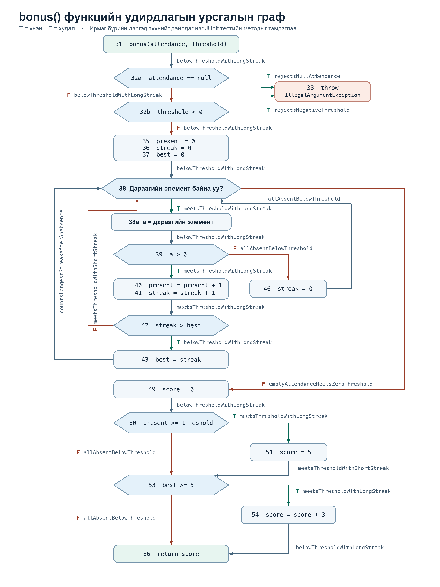

# Лаборатори №10 Өгөгдлийн урсгалын тест

- **Нэр** Л.Мөнхжин
- **Оюутны код** B242270094
- **Хичээл** F.CSA313 Программ хангамжийн чанарын баталгаа ба тест

`java -version`

```text
openjdk version "21.0.10" 2026-01-20
OpenJDK Runtime Environment Homebrew (build 21.0.10)
OpenJDK 64-Bit Server VM Homebrew (build 21.0.10, mixed mode, sharing)
```

`mvn -version`

```text
Apache Maven 3.9.12 (848fbb4bf2d427b72bdb2471c22fced7ebd9a7a1)
Maven home: /opt/homebrew/Cellar/maven/3.9.12/libexec
Java version: 21.0.10, vendor: Homebrew, runtime: /opt/homebrew/Cellar/openjdk@21/21.0.10/libexec/openjdk.jdk/Contents/Home
Default locale: en_MN, platform encoding: UTF-8
OS name: "mac os x", version: "26.3.1", arch: "aarch64", family: "mac"
```

## A. `gcd`-ийн DU хосууд

13-р мөрд `x`, `y` анх тодорхойлогдоно. 14-р мөрд `tmp`-г зарлаж, 16-р мөрд утга онооно. 15-р мөрийн нөхцөл `y`-г p-use хэлбэрээр ашиглана. 16-р мөрд `x`, `y`, 17-р мөрд `y`, 18-р мөрд `tmp`, 20-р мөрд `x` нь c-use болно. 16, 17, 18-р мөрийн оноолтууд харгалзан `tmp`, `x`, `y`-г тодорхойлно.

`T` ба `F` нь нөхцөлийн үнэн, худал салаа. Нөхцөлийн салаагаар төгсөх замд салааны эхний зангилааг хаалтад тэмдэглэв. Нэг мөрөнд use ба def давхцахад баруун талыг эхэлж үнэлдэг тул төгсгөлийн use хүртэлх зам def-clear хэвээр байна.

| Хувьсагч | Def мөр | Use мөр | Төрөл | Def-clear зам | Тестийн ID | Хамрагдсан |
|---|---:|---:|---|---|---|---|
| `x` | 13 | 16 | c-use | 13 → 15T → 16 | G2 | Тийм |
| `x` | 13 | 20 | c-use | 13 → 15F → 20 | G1 | Тийм |
| `x` | 17 | 16 | c-use | 17 → 18 → 15T → 16 | G2 | Тийм |
| `x` | 17 | 20 | c-use | 17 → 18 → 15F → 20 | G2 | Тийм |
| `y` | 13 | 15T | p-use | 13 → 15T (16) | G2 | Тийм |
| `y` | 13 | 15F | p-use | 13 → 15F (20) | G1 | Тийм |
| `y` | 13 | 16 | c-use | 13 → 15T → 16 | G2 | Тийм |
| `y` | 13 | 17 | c-use | 13 → 15T → 16 → 17 | G2 | Тийм |
| `y` | 18 | 15T | p-use | 18 → 15T (16) | G2 | Тийм |
| `y` | 18 | 15F | p-use | 18 → 15F (20) | G2 | Тийм |
| `y` | 18 | 16 | c-use | 18 → 15T → 16 | G2 | Тийм |
| `y` | 18 | 17 | c-use | 18 → 15T → 16 → 17 | G2 | Тийм |
| `tmp` | 16 | 18 | c-use | 16 → 17 → 18 | G2 | Тийм |

| ID | Тестийн метод | Оролт | Хүлээгдсэн үр дүн | Гүйцэтгэлийн тайлбар |
|---|---|---|---:|---|
| G1 | `returnsInitialXWhenYIsZero` | `(7, 0)` | 7 | Эхний шалгалт 15F салаагаар гарч, `y`-ийн 13 → 15F болон `x`-ийн 13 → 20 хосыг хамарна. |
| G2 | `returnsGcdAfterTwoIterations` | `(12, 8)` | 4 | `(x, y)` нь `(12, 8) → (8, 4) → (4, 0)` болж, хоёр давталт хийнэ. Эхний давталтаас дараагийн давталт руу `x`-ийн 17 → 16, `y`-ийн 18 → 15T, 18 → 16, 18 → 17 хосууд хүрнэ. Хоёр дахь давталтын дараа 18 → 15F болон 17 → 20 хосуудыг хамарна. |

Хоёр тест нийт 13/13 хосыг хамарна. `y`-ийн 13-р мөрийн def нь эхний шалгалтаар 15T болон 15F-ийн зөвхөн нэгээр дамжих тул all-DU-pairs-д дор хаяж хоёр оролт шаардлагатай.

## B. `bonus`-ийн өгөгдлийн урсгал

### B1 Удирдлагын урсгалын граф

Графын зангилаанд `DataFlowTargets.java` файлын мөр, ирмэг бүрд түүнийг дайрдаг нэг JUnit тестийн методыг бичсэн. Дараалсан оноолтуудыг нэг үндсэн блокт багтаав.



### B2 Мөр тус бүрийн def ба use

| Мөр | Def | c-use | p-use |
|---|---|---|---|
| 31 | `attendance`, `threshold` | — | — |
| 32a | — | — | `attendance == null` |
| 32b | — | — | `threshold < 0` |
| 33 | — | — | — |
| 35 | `present` | — | — |
| 36 | `streak` | — | — |
| 37 | `best` | — | — |
| 38 | — | — | `attendance`-д дараагийн элемент байгаа эсэх |
| 38a | `a` | — | — |
| 39 | — | — | `a > 0` |
| 40 | `present` | `present` | — |
| 41 | `streak` | `streak` | — |
| 42 | — | — | `streak > best` |
| 43 | `best` | `streak` | — |
| 46 | `streak` | — | — |
| 49 | `score` | — | — |
| 50 | — | — | `present >= threshold` |
| 51 | `score` | — | — |
| 53 | — | — | `best >= 5` |
| 54 | `score` | `score` | — |
| 56 | — | `score` | — |

32a ба 32b нь 32-р мөрийн `||`-ийн зүүн, баруун нөхцөл. 32a үнэн үед 33 руу шууд шилжиж, 32b-г тооцохгүй. 38a нь 38-р мөрийн for-each дараагийн элементийг `a`-д оноох үйлдэл. 40, 41, 54-р мөрд баруун талын утгыг ашигласны дараа шинэ утгыг онооно.

### B3 Def-clear DU хосууд

Predicate-ийн үнэн, худал ирмэгийг тусад нь тооцов. Зам дахь `42T → 43` тэмдэглэгээ нь 42-р мөрийн үнэн ирмэгээр 43 руу орсныг заана. P-use-ийн зам тухайн ирмэгийн төгсгөл хүртэл үргэлжилнэ. Нэг боломжит замыг жишээ болгон харгалзах тест бүрээр гүйцэтгүүлсэн.

| Хувьсагч | Def мөр | Use мөр | Төрөл | Def-clear зам | Тестийн ID | Хамралт |
|---|---:|---|---|---|---|---|
| `attendance` | 31 | 32aT | p-use | 31 → 32aT → 33 | B6 | Тийм |
| `attendance` | 31 | 32aF | p-use | 31 → 32aF → 32b | B1 | Тийм |
| `attendance` | 31 | 38T | p-use | 31 → 32aF → 32bF → 35 → 36 → 37 → 38T → 38a | B1 | Тийм |
| `attendance` | 31 | 38F | p-use | 31 → 32aF → 32bF → 35 → 36 → 37 → 38F → 49 | B3 | Тийм |
| `threshold` | 31 | 32bT | p-use | 31 → 32aF → 32bT → 33 | B7 | Тийм |
| `threshold` | 31 | 32bF | p-use | 31 → 32aF → 32bF → 35 | B1 | Тийм |
| `threshold` | 31 | 50T | p-use | 31 → 32aF → 32bF → 35 → 36 → 37 → 38F → 49 → 50T → 51 | B3 | Тийм |
| `threshold` | 31 | 50F | p-use | 31 → 32aF → 32bF → 35 → 36 → 37 → 38T → 38a → 39F → 46 → 38F → 49 → 50F → 53 | B4 | Тийм |
| `a` | 38a | 39T | p-use | 38a → 39T → 40 | B1 | Тийм |
| `a` | 38a | 39F | p-use | 38a → 39F → 46 | B4 | Тийм |
| `present` | 35 | 40 | c-use | 35 → 36 → 37 → 38T → 38a → 39T → 40 | B1 | Тийм |
| `present` | 35 | 50T | p-use | 35 → 36 → 37 → 38F → 49 → 50T → 51 | B3 | Тийм |
| `present` | 35 | 50F | p-use | 35 → 36 → 37 → 38T → 38a → 39F → 46 → 38F → 49 → 50F → 53 | B4 | Тийм |
| `present` | 40 | 40 | c-use | 40 → 41 → 42T → 43 → 38T → 38a → 39T → 40 | B1 | Тийм |
| `present` | 40 | 50T | p-use | 40 → 41 → 42F → 38F → 49 → 50T → 51 | B2 | Тийм |
| `present` | 40 | 50F | p-use | 40 → 41 → 42F → 38F → 49 → 50F → 53 | B1 | Тийм |
| `streak` | 36 | 41 | c-use | 36 → 37 → 38T → 38a → 39T → 40 → 41 | B1 | Тийм |
| `streak` | 41 | 41 | c-use | 41 → 42T → 43 → 38T → 38a → 39T → 40 → 41 | B1 | Тийм |
| `streak` | 41 | 42T | p-use | 41 → 42T → 43 | B1 | Тийм |
| `streak` | 41 | 42F | p-use | 41 → 42F → 38 | B2 | Тийм |
| `streak` | 41 | 43 | c-use | 41 → 42T → 43 | B1 | Тийм |
| `streak` | 46 | 41 | c-use | 46 → 38T → 38a → 39T → 40 → 41 | B1 | Тийм |
| `best` | 37 | 42T | p-use | 37 → 38T → 38a → 39T → 40 → 41 → 42T → 43 | B1 | Тийм |
| `best` | 37 | 42F | p-use | 37 → 38T → 38a → 39T → 40 → 41 → 42F → 38 | — | Биелэшгүй |
| `best` | 37 | 53T | p-use | 37 → 38F → 49 → 50F → 53T → 54 | — | Биелэшгүй |
| `best` | 37 | 53F | p-use | 37 → 38F → 49 → 50T → 51 → 53F → 56 | B3 | Тийм |
| `best` | 43 | 42T | p-use | 43 → 38T → 38a → 39T → 40 → 41 → 42T → 43 | B1 | Тийм |
| `best` | 43 | 42F | p-use | 43 → 38T → 38a → 39F → 46 → 38T → 38a → 39T → 40 → 41 → 42F → 38 | B2 | Тийм |
| `best` | 43 | 53T | p-use | 43 → 38F → 49 → 50T → 51 → 53T → 54 | B5 | Тийм |
| `best` | 43 | 53F | p-use | 43 → 38T → 38a → 39F → 46 → 38T → 38a → 39T → 40 → 41 → 42F → 38F → 49 → 50T → 51 → 53F → 56 | B2 | Тийм |
| `score` | 49 | 54 | c-use | 49 → 50F → 53T → 54 | B1 | Тийм |
| `score` | 49 | 56 | c-use | 49 → 50F → 53F → 56 | B4 | Тийм |
| `score` | 51 | 54 | c-use | 51 → 53T → 54 | B5 | Тийм |
| `score` | 51 | 56 | c-use | 51 → 53F → 56 | B2 | Тийм |
| `score` | 54 | 56 | c-use | 54 → 56 | B1 | Тийм |

CFG-д def-clear замтай 35 хосоос биелэх боломжтой 33-ыг B1–B7 хамарсан.

- `best` 37 → 42F. 37-ын утгаар анх 42-т ирэхэд `best = 0`, `streak = 1` тул нөхцөл үнэн болж, 43 уг тодорхойлолтыг дарна.
- `best` 37 → 53T. 37-ын тодорхойлолт 53 хүртэл хадгалагдсан бол `best = 0` хэвээр тул `best >= 5` худал.
- 46-р мөрийн `streak = 0` нь тухайн үед хүчинтэй 36, 41 эсвэл өмнөх 46-р мөрийн `streak`-ийн тодорхойлолтыг дарна. Иймээс 36 → 41, 41 → 41 зам завсраа 46-аар дайрвал хүчингүй. Дараалсан таслалтын сүүлчийн 46 л дараагийн 41-д хүрнэ.
- `streak` 36 → 42T/42F/43 болон 46 → 42T/42F/43 хослол бүрд 41-ийн шинэ оноолт урьтаж хийгддэг тул def-clear зам байхгүй.
- `score` 49 → 54 эсвэл 49 → 56 зам 51-ээр дамжвал 49-ийн утга дарагдана. 49 → 56 болон 51 → 56 зам 54-өөр дамжвал 56-д 54-ийн шинэ утга хүрнэ. 54-ийн шинэ утга `score`-ийн 54 дэх use-д дахин хүрэх боломжгүй. Тэр use нь оноолтын өмнө хийгддэг бөгөөд 54 рүү буцах ирмэг байхгүй.

### B4 All-defs-ийн хамгийн бага тестийн тоо

All-defs-д `bonus`-ийн хамгийн багадаа хоёр өөр дуудалт хэрэгтэй. Дуудалт тус бүрийг нэг тестийн методоор шалгав. 49-р мөрийн `score = 0` оноолтын дараах анхны боломжит use нь 54 эсвэл 56. 51-р мөрийн `score = 5` биелсэн нэг дуудалтад 49-ийн утга тэдгээр use-д хүрэхээсээ өмнө дарагдана. Иймээс нэг дуудалт 49 ба 51-ийн тодорхойлолтыг хоёуланг нь use-д хүргэж чадахгүй.

| ID | Тестийн метод | `attendance` | `threshold` | Хүлээсэн оноо | All-defs-д хамарсан тодорхойлолт |
|---|---|---|---:|---:|---|
| B1 | `belowThresholdWithLongStreak` | `{1, 1, 1, 1, 1, 0, 1}` | 7 | 3 | 31-ийн 2 параметр, 35, 36, 37, 38a, 40, 41, 43, 46, 49, 54 |
| B2 | `meetsThresholdWithShortStreak` | `{1, 0, 1}` | 2 | 5 | 51 → 56 |

| ID | Нэмж бичсэн тестийн метод | Оролт | Хүлээсэн үр дүн | All-defs-ийн дараа нэмж хамарсан хос |
|---|---|---|---|---|
| B3 | `emptyAttendanceMeetsZeroThreshold` | `{}`, 0 | 5 | `present` 35 → 50T, `best` 37 → 53F |
| B4 | `allAbsentBelowThreshold` | `{0}`, 1 | 0 | `present` 35 → 50F, `score` 49 → 56 |
| B5 | `meetsThresholdWithLongStreak` | `{1, 1, 1, 1, 1, 1}`, 6 | 8 | `score` 51 → 54 |
| B6 | `rejectsNullAttendance` | `null`, 0 | `IllegalArgumentException` | `attendance` 31 → 32aT |
| B7 | `rejectsNegativeThreshold` | `{}`, −1 | `IllegalArgumentException` | `threshold` 31 → 32bT |

### B5 Branch болон DU хамралт

Gcd-ийн бүх тестийг B1, B2, B6, B7-той хамт авч үзвэл JaCoCo-гийн 16 салаа бүгд дайрагдана. Энэ багцад `present` 35 → 50T/50F, `best` 37 → 53F, `score` 49 → 56, `score` 51 → 54 гэсэн таван DU хос үлдэнэ. Жишээ нь B1 ба B2 50-р мөрийн хоёр салааг дайрахдаа хоёул 40-р мөрд шинэчилсэн `present`-ийг ашигладаг. B3 ба B4-д 35-р мөрийн анхны 0 утга 40-өөр солигдолгүйгээр 50-ийн хоёр салаанд хүрнэ.

JaCoCo-ийн `DataFlowTargets` классын хэмжилт

| Шат | Нийт тест | Салаа хамрагдсан | Салаа үлдсэн | Мөр хамрагдсан | Мөр үлдсэн |
|---|---:|---:|---:|---:|---:|
| [All-defs](results/jacoco-alldefs.csv) | 4 | 14/16 | 2 | 22/24 | 2 |
| [Эцсийн](results/jacoco-final.csv) | 10 | 16/16 | 0 | 23/24 | 1 |

All-defs шатны 4 тестийн 2 нь `gcd`, 2 нь `bonus`-ийг шалгасан. Энэ шатанд 32a, 32b нөхцөлийн үнэн салаанууд болон 33-р мөрийн `throw` хамрагдаагүй. Эцсийн тайлангийн ганц хамрагдаагүй мөр нь 7-р мөрд тооцогдсон далд constructor юм. Тестийн тоог [all-defs](results/mvn-verify-alldefs.txt) болон [эцсийн](results/mvn-verify-final.txt) логт хадгалсан.

Дээрх 6 тестийн дэд багцыг цэвэр clone дээр тусад нь ажиллуулж, JaCoCo-д `BRANCH_MISSED = 0`, `BRANCH_COVERED = 16` болохыг шалгав.

```sh
mvn '-Dtest=GcdTest,BonusTest#belowThresholdWithLongStreak+meetsThresholdWithShortStreak+rejectsNullAttendance+rejectsNegativeThreshold' clean verify
```

## C. Fault seeding

Мутаци бүрийг эх файлд дангаар нь оруулж туршсан. Мутацийн дараа `git restore`-оор эх файлыг сэргээсэн. M2-т нэмэлт B8 тестийг мутаци идэвхтэй үед ажиллуулсан.

| Мутаци | Өөрчлөлт | Tests run | Failures | Логийн үр дүн |
|---|---|---:|---:|---|
| [M1](results/mvn-test-M1.txt) | 41-р мөрийн `streak = streak + 1`-ийг хасав | 9 | 2 | `BonusTest.belowThresholdWithLongStreak:15 expected: <3> but was: <0>`<br>`BonusTest.meetsThresholdWithLongStreak:43 expected: <8> but was: <5>` |
| [M2](results/mvn-test-M2.txt) | 43-р мөрд `best = present` болгосон | 9 | 0 | `BUILD SUCCESS` |
| [M2 ба B8](results/mvn-test-M2-kill.txt) | M2 идэвхтэй үед B8-ыг нэмсэн | 10 | 1 | `BonusTest.countsLongestStreakAfterAnAbsence:63 expected: <5> but was: <8>` |
| [M3](results/mvn-test-M3.txt) | Давталтын дараа `int total = present + best;` нэмсэн | 10 | 0 | `BUILD SUCCESS` |

**M1.** `streak` тэгээс өсөхгүй тул `best` тэг хэвээр үлдэнэ. B1 ба B5-ын хүлээсэн дараалсан ирцийн 3 оноо алга болсон.

**M2.** B1, B2, B5-д 43-р мөр биелэх бүрд `present` ба `streak` тэнцүү байсан. B1, B2-т тасалсны дараах богино цуваа өмнөх дээд утгыг даваагүй тул `best` дахин өөрчлөгдөөгүй. B8-д `{1, 1, 1, 0, 1, 1, 1, 1}` массив, `threshold = 7` өгсөн. Сүүлчийн өдөр `streak = 4` нь өмнөх `best = 3`-ыг давахад зөв код `best = 4`, мутацитай код `best = 7` болгосон. Үүний улмаас мутацитай код дараалсан ирцийн 3 оноог илүү нэмж 8 буцаав.

**M3.** Тооцоолсон `total`-ыг дараагийн мөрүүд уншихгүй тул буцаах оноо хэвээр байна. Maven-ийн `javac` хөрвүүлэлт энэ хувьсагч дээр анхааруулга гаргаагүй. VS Code-ийн Red Hat Java өргөтгөлд багтсан Eclipse JDT-г `unusedLocal` шалгалттай ажиллуулахад 49-р мөрд дараах анхааруулга гарсан.

> The value of the local variable total is not used

## Дүгнэлт

DU шинжилгээ ашиглах цэгт аль оноолтын утга хүрч байгааг шалгадаг. Жишээ нь 50-р мөрийн хоёр салаа ажилласан ч `present`-ийн анхны 0 утгыг ашигласан эсэхийг JaCoCo-гийн салааны тайлангаас мэдэх боломжгүй. `bonus`-ийн нэг дуудалтад 49 ба 51-р мөрийн `score`-ийг хоёуланг нь use-д хүргэх боломжгүй учраас all-defs-д хоёр оролт хэрэгтэй байв. DU хос бүрийг хамарсан тестүүд M2-ийг илрүүлэхэд хангалтгүй байсан бөгөөд тасалсны дараа шинэ дээд цуваа үүсэх оролт шаардсан. M3-ийг ашиглаагүй хувьсагчийн статик шалгалтаар илрүүлсэн. Хамгийн их хугацаа `bonus`-ийн def-clear замуудыг бодит тестийн оролттой тулгаж, биелэхгүй салааг үндэслэхэд зарцуулагдсан. Салааны тайланг хурдан гаргаж болох бол DU хүснэгтэд дахин оноолт, давталт болон оролтын утгыг хамтад нь шалгах шаардлагатай.
